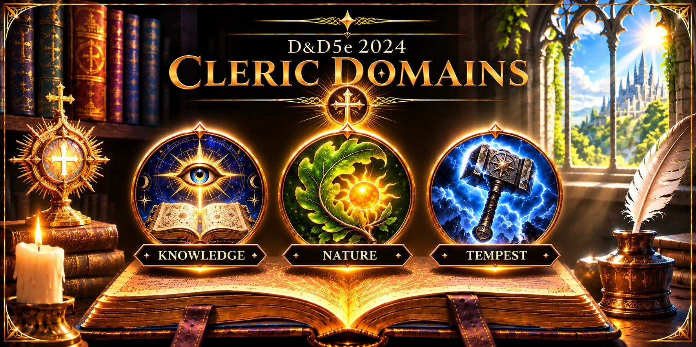
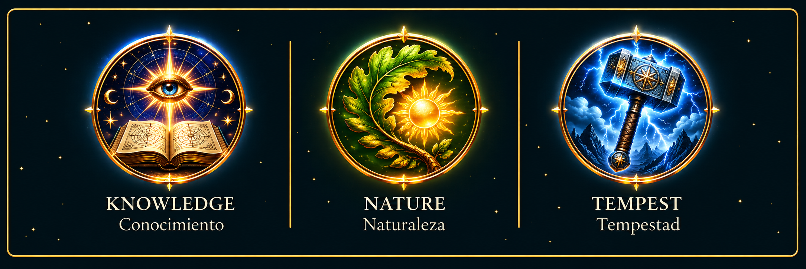
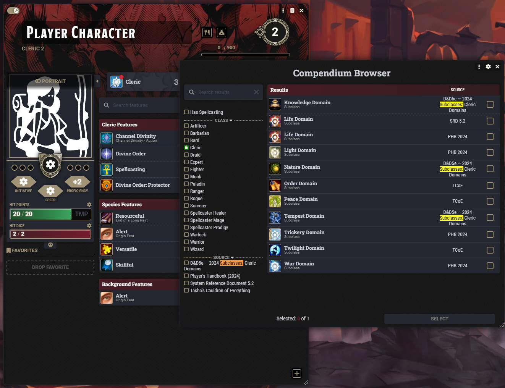
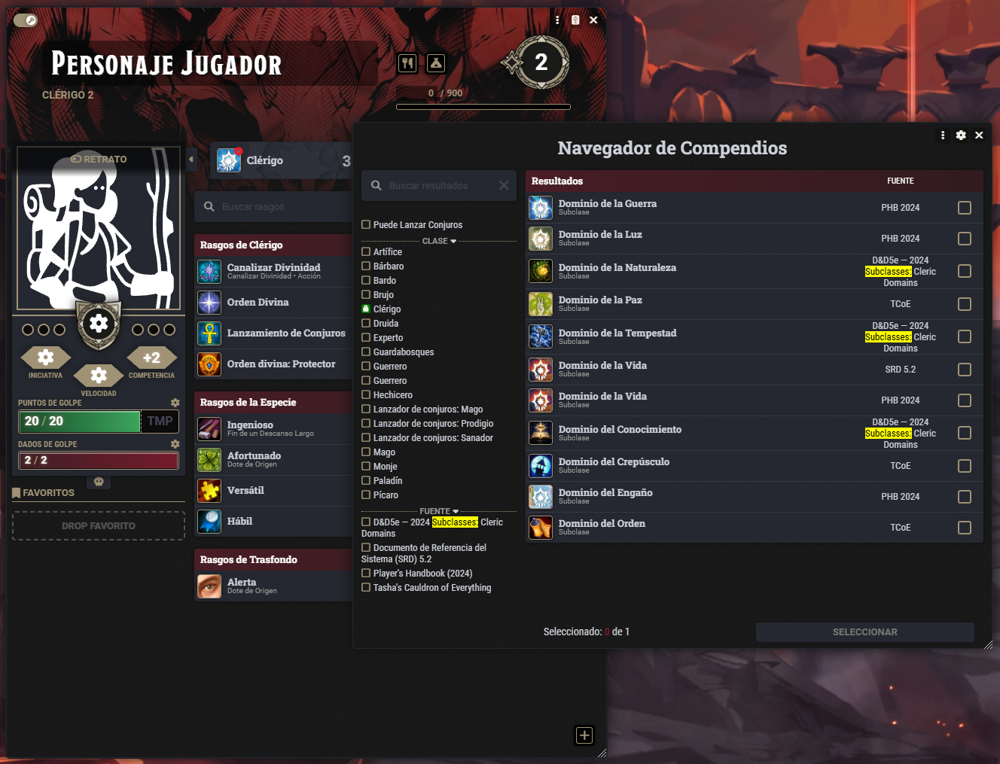

# D&D 2024 — Cleric Domains

[Español](README.md) | **English**

<p align="center">
  
</p>


[](https://github.com/foundryvtt-sinregistrar/dnd5e-2024-cleric-domains/releases/latest)
[](https://github.com/foundryvtt-sinregistrar/dnd5e-2024-cleric-domains/releases/latest)
[](https://github.com/foundryvtt-sinregistrar/dnd5e-2024-cleric-domains/releases)

Adds the 2014 Knowledge, Nature, and Tempest Cleric domains to the 2024 Cleric progression.

## Status

Compatible with Foundry VTT 14.367 or newer and dnd5e 6.0.3 or newer. Version 1.14.0 was verified with Foundry VTT 14.370 and dnd5e 6.0.6.

## Requirements

- Foundry VTT 14.367 or newer.
- The dnd5e system 6.0.3 or newer.
- The official *Dungeons & Dragons Player's Handbook* (PHB 2024) module.

## Installation

Install from Foundry's Add-on Modules browser using this manifest:

```text
https://github.com/foundryvtt-sinregistrar/dnd5e-2024-cleric-domains/releases/latest/download/module.json
```

Enable the module alongside dnd5e and PHB 2024 in the relevant world.

## Activation and use

The native **D&D 2024 - Cleric Domains** compendium contains 19 documents in three folders. Drag a domain and its features to a Cleric as you would any other dnd5e compendium content.

Features are adapted to subclass levels 3, 6, 10, and 14. Some 2014 options need a Channel Divinity use or manual configuration; each case is documented in that feature's secret GM note.

## Updating

Document IDs, UUIDs, and automation identifiers remain stable. Imported actor copies are not synchronized automatically; consult the current compendium when incorporating later changes.

## Included content

- Knowledge domain.
- Nature domain.
- Tempest domain.
- Optional automation and safe target checks for complex features.

## Limitations

Not every 2014 subclass capability can be automated without user input. GM notes identify the required manual actions.

## Support and contributions

Report or follow issues in the [module repository](https://github.com/foundryvtt-sinregistrar/dnd5e-2024-cleric-domains/issues).

## Development

The stable-ID and translation contract is documented in [LOCALIZATION.md](LOCALIZATION.md). The Babele Spanish translation is distributed as the separate `translate-dnd5e-cleric-domains-2024-es` module.

## Screenshots

The three domains included in the module:



Choosing a Cleric domain when the character reaches level 3, with the base compendium in English:



With the [Cleric Domains Spanish Translation](https://github.com/foundryvtt-sinregistrar/translate-dnd5e-cleric-domains-2024-es) module and Babele enabled, the same selector is displayed in Spanish:

[](https://github.com/foundryvtt-sinregistrar/translate-dnd5e-cleric-domains-2024-es)

## License and credits

See [LICENSE](LICENSE) and [CHANGELOG.md](CHANGELOG.md).
